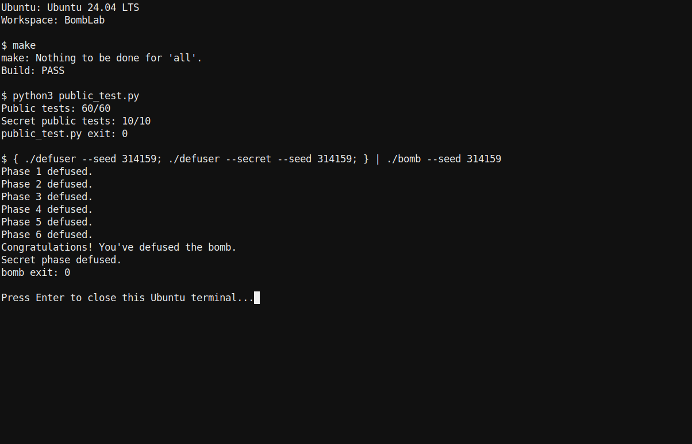

# Lab2: BombLab实验报告

**学号：**25301020126

## 实验环境

在WSL Ubuntu（Linux x86_64）中用GCC编译程序，以GNU objdump查看反汇编，并用GDB检查关键寄存器。课程仓库的`fetch_bomb.py`负责获取个人炸弹并校验下载包和炸弹文件。

各关卡先从challenge和输入行中取值，再比较计算结果与输入字段。分析沿寄存器、函数调用和分支条件追踪数据流；C解法使用`uint32_t`，让32位加、减、乘按模$2^{32}$回绕，与`eax`中的结果一致。

## Phase1：函数调用与返回值

`phase_01`读取一个整数后调用`p1_compute`。该函数从challenge拆出低32位、高32位以及右移16位后的低32位，依次调用`p1_step2`、`p1_step0`和`p1_step1`。

    shr rax, 0x20
    call p1_step2
    ...
    call p1_step0
    ...
    call p1_step1
    cmp DWORD PTR [rbp-0x14], eax

令$L=c\bmod2^{32}$、$H=(c\gg32)\bmod2^{32}$、$Q=(c\gg16)\bmod2^{32}$，前两个子函数的结果分别为

$$
u=(3H+L)\oplus\texttt{0x5886},\qquad
v=(L+4Q)\oplus\texttt{0xad08}.
$$

`p1_step1`先将$u$与`0x5d8e`异或，再加上$2v$，所以口令为

$$
\operatorname{ans}_1=2v+(u\oplus\texttt{0x5d8e})\pmod{2^{32}}.
$$

## Phase2：递推关系

第一项由challenge右移34位并取6位得到，后五项在循环中生成。循环每轮把移位量加2、把下标加1，并把当前项写回`esi`；下一轮的异或操作因此使用前一项。

    shr rax, 0x22
    and eax, 0x3f
    lea eax, [rax+rax*2]
    ...
    shr rax, cl
    and eax, 0x1f
    add eax, edx
    xor eax, esi
    lea eax, [rax+rax*4]

六个口令字段满足

$$
v_0=3((c\gg34)\mathbin{\&}\texttt{0x3f}),
$$

$$
q_i=((c\gg(2i+3))\mathbin{\&}\texttt{0x1f})+i,\qquad
v_i=5(q_i\oplus v_{i-1})\pmod{2^{32}},\quad1\le i\le5.
$$

## Phase3：跳转表

第一项为$k=c\mathbin{\&}7$，传入分支函数的参数为

$$
m=((c\gg32)\oplus(c\gg3))\bmod2^{32}.
$$

`p3_dispatch`用$k$索引间接跳转表；表项地址经跳转块进入具体函数。按表内目标地址恢复出的映射如下：

| $k$ | 分支函数 | 第二项 |
|---:|---|---|
| 0 | `p3_case_1` | $3m+\texttt{0x87ba}$ |
| 1 | `p3_case_0` | $5m+\texttt{0x48652}$ |
| 2 | `p3_case_4` | $(m\oplus\texttt{0x286})+(m\gg2)$ |
| 3 | `p3_case_6` | $5m+\texttt{0x6b3f}$ |
| 4 | `p3_case_5` | $3m+\texttt{0x33dd}$ |
| 5 | `p3_case_2` | $(2m)\oplus\texttt{0xf8ba}$ |
| 6 | `p3_case_7` | $(4m)\oplus\texttt{0x60ec}$ |
| 7 | `p3_case_3` | $(m\oplus\texttt{0x80c9})+(m\gg2)$ |

输出字段依次为$k$和表中对应的分支结果。

## Phase4：递归查找

目标值为$t=c\mathbin{\&}\texttt{0x7f}$，递归参数为$z=((c\gg7)\oplus(c\gg32))\bmod2^{32}$，初始区间为$[0,127]$。每层计算

$$
m=\ell+\left\lfloor\frac{h-\ell}{2}\right\rfloor.
$$

命中中点时返回$(m+\texttt{0x7c})\oplus z$。未命中时，返回路径在回溯阶段编码中点、递归结果和分支方向：

$$
F(t,\ell,h,z)=
\begin{cases}
(m+\texttt{0x7c})\oplus z,&t=m,\\
(3F(t,\ell,m-1,z))\oplus(m+z)\oplus\texttt{0x14},&t<m,\\
(3F(t,m+1,h,z))\oplus(m+z)\oplus\texttt{0x09},&t>m.
\end{cases}
$$

Phase4的唯一口令字段为$F(t,0,127,z)$。

## Phase5：结构体与链表

`p5_traverse`用$c\mathbin{\&}7$从八项指针表选择头节点，再沿`next`指针遍历$d=(c\gg3)\mathbin{\&}3$次。节点大小为16字节：偏移0是累加字段$a$，偏移4是输出字段$b$，偏移8是64位下一节点指针。

指针表下标到头节点编号的映射为：

| 指针表下标 | 0 | 1 | 2 | 3 | 4 | 5 | 6 | 7 |
|---|---:|---:|---:|---:|---:|---:|---:|---:|
| 头节点编号 | 1 | 9 | 0 | 5 | 7 | 2 | 10 | 4 |

按二进制中的节点地址递增编号后，节点内容如下；“结束”表示空指针。

| 节点 | $a$ | $b$ | next | 节点 | $a$ | $b$ | next |
|---:|---:|---:|---:|---:|---:|---:|---:|
| 0 | `0xae01` | 11 | 5 | 1 | `0x77f1` | `0x064e` | 9 |
| 2 | `0xef97` | `0x0854` | 10 | 3 | `0xcb47` | `0x0a15` | 结束 |
| 4 | `0x707e` | `0x0405` | 8 | 5 | `0xd8ba` | `0x035b` | 7 |
| 6 | `0x16c7` | `0x092d` | 11 | 7 | `0x3280` | `0x0203` | 2 |
| 8 | `0x4737` | `0x0739` | 6 | 9 | `0xc922` | `0x0115` | 0 |
| 10 | `0x1937` | `0x0528` | 4 | 11 | `0x34c8` | `0x0b3d` | 3 |

若头节点为$n_0$，初值为

$$
A_0=5\left(\left(
\left(((c\gg6)\oplus(c\gg32))\bmod2^{32}\right)
\oplus\texttt{0xdbcf}\right)+a(n_0)\right)\oplus b(n_0).
$$

每经过一个后继节点$n_j$，更新

$$
A_j=5(A_{j-1}+a(n_j))\oplus b(n_j)\pmod{2^{32}}.
$$

最终两项依次为$A_d$和$b(n_d)$。

## Phase6：函数指针表

输入给第一层操作函数的值为

$$
x=((c\gg6)\oplus(c\gg32))\bmod2^{32}.
$$

函数指针表的操作编号顺序为$[2,5,1,4,1,3,0,5]$。令下标$j$对应的操作编号为$T[j]$，那么

$$
\operatorname{ans}_6=
\operatorname{Op}_{T[(c\gg3)\mathbin{\&}7]}
\left(\operatorname{Op}_{T[c\mathbin{\&}7]}(x)\oplus\texttt{0xd141}\right)
+\texttt{0x6658}\pmod{2^{32}}.
$$

| 操作编号 | 变换 |
|---:|---|
| 0 | $(x\oplus\texttt{0x5c2a})+4x$ |
| 1 | $\operatorname{ROL}_{32}(x,5)\oplus\texttt{0xc69a}$ |
| 2 | $\operatorname{ROR}_{32}(x,7)$ |
| 3 | $(2x+\texttt{0x9966})\oplus5x$ |
| 4 | $(x\oplus(x\gg1))+\texttt{0x4831}$ |
| 5 | $(x+\texttt{0x221})\oplus(x\gg7)$ |

## Honor：门控前缀与上下文

`secret_gate`要求整行长度在36至163字节之间，第32至35字节为`OPEN`，之后才把偏移36处的文本交给`secret_phase`。解法使用32字节填充串`0123456789abcdef0123456789abcdef`，紧接`OPEN `，再写入三个十进制字段。

设$c$是Honor challenge，$t$是前六行答案形成的context，定义

$$
C=(c\bmod2^{32})\oplus((c\gg32)\bmod2^{32}),\qquad
T=(t\bmod2^{32})\oplus((t\gg32)\bmod2^{32}),\qquad
a=t\mathbin{\&}3.
$$

`secret_mix`执行`ror eax,0x7`后异或`0xaf45`。因此第二、三字段为

$$
b=\operatorname{ROR}_{32}(C\oplus T,7)\oplus\texttt{0xaf45}
\oplus\left((a\cdot\texttt{0x160e})\oplus((t\gg16)\bmod2^{32})\right),
$$

$$
d=b\oplus\left(T+a+\texttt{0xb94b}+(C\gg7)\right)\pmod{2^{32}}.
$$

输出的三个数字依次是$a$、$b$、$d$。

## 结果截图

`make`编译通过，`python3 public_test.py`的六关测试为60/60，Honor测试为10/10；再以seed `314159`运行完整炸弹，六关和Honor均成功。下图记录了测试汇总和该次运行的逐关输出。

## 工具与参考资料

分析时用GNU objdump查看反汇编、用GDB检查Honor中间寄存器；chatGPT协助梳理数据流和参数化公式，解法由WSL中的GCC编译，并通过个人炸弹与课程`public_test.py`核验；用AI来进行md文档的排版。

1. 复旦大学计算机系统基础课程组，《Lab2: BombLab（2026年秋季学期）》，[实验说明](https://ics-26fall-fdu.github.io/labs/lab2-bomb-lab/)。
2. ICS-26Fall-FDU，[BombLab课程模板仓库](https://github.com/ICS-26Fall-FDU/BombLab)。
3. GNU Project，[GDB文档](https://sourceware.org/gdb/documentation/)。
4. GNU Binutils，[objdump文档](https://sourceware.org/binutils/docs/binutils/objdump.html)。
